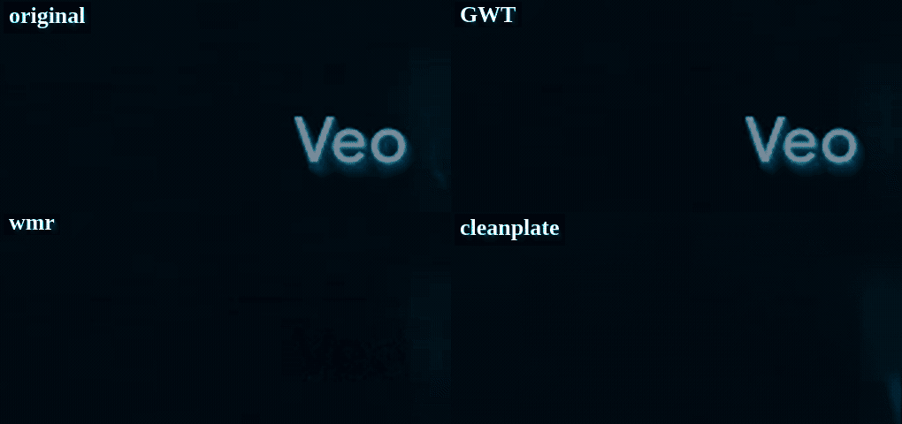
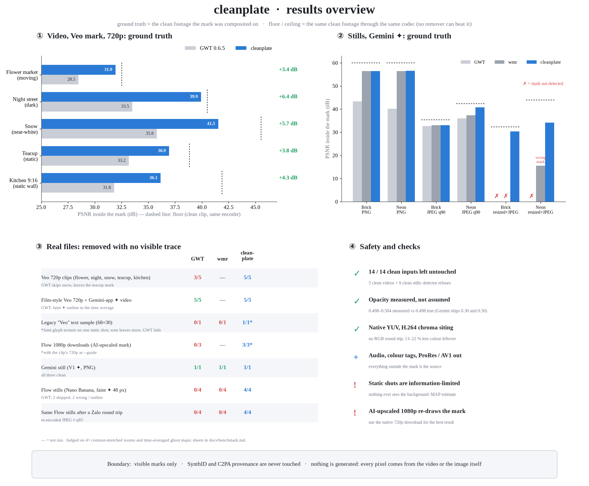
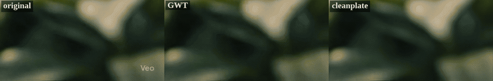
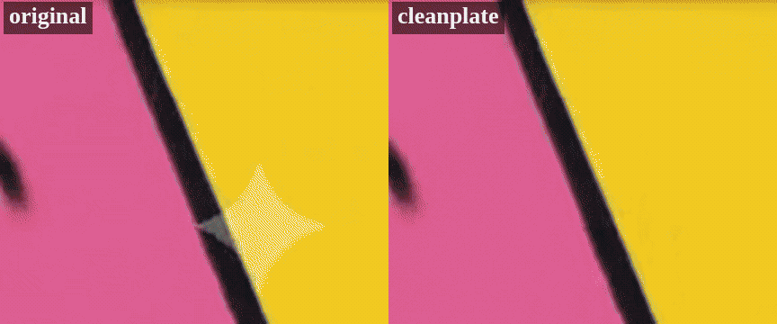
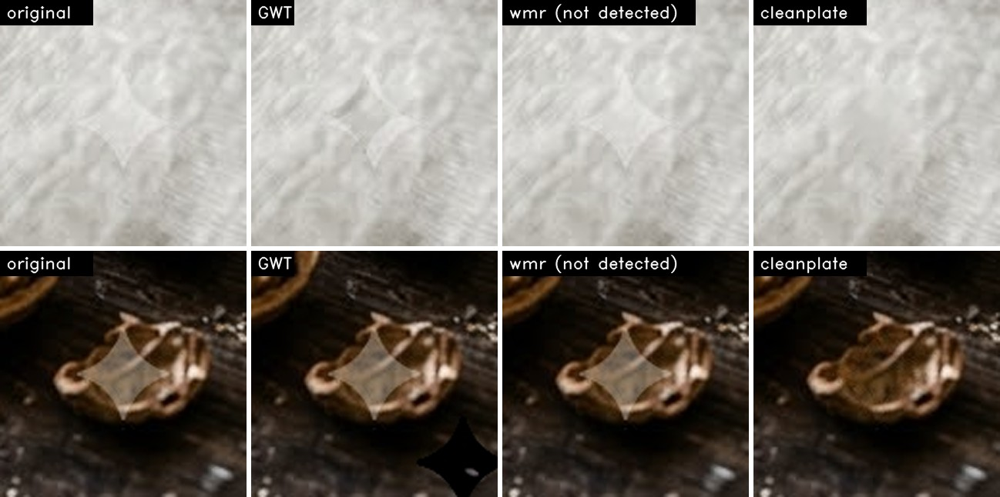

<div align="center">

# cleanplate

### Remove the visible AI mark, keep the picture. Nothing invented, nothing blurred.

[](https://github.com/dieplai/cleanplate/actions/workflows/ci.yml)
[](https://github.com/dieplai/cleanplate/releases/latest)
[](https://github.com/dieplai/cleanplate/releases)
[](./LICENSE)
[](#install)
[](https://dieplai.github.io/cleanplate/)

**English** · [Tiếng Việt](./README.vi.md)

</div>

<p align="center"></p>

cleanplate removes the **visible** marks that AI generators stamp on their output (Google Veo's "Veo" text and
Gemini / Nano Banana's ✦ diamond) from **videos and still images**, and gives back footage that looks like it never
had one. It is made for creators who use these tools for non-commercial work and need a clean plate for a scene, an
edit or a thumbnail.

Other removers invert the overlay frame by frame, then hide what is left with a blur or an AI inpainter, which leaves
a soft patch. cleanplate uses what a video already has: **the scene moves under the mark, so almost every hidden pixel
is visible, clean, in another frame.** It rebuilds the mark area from those real pixels. On stills it measures the
mark's exact opacity and position on your image instead of assuming them.

| Ground truth, PSNR inside the mark (dB, higher is better) | GWT 0.6.5 | wmr 1.17 | **cleanplate** | ceiling |
|---|---|---|---|---|
| Video, Veo 720p, 5 clips (mean) | 32.6 | — | **37.3** | 39.9 |
| Still, Gemini ✦ PNG (brick / neon) | 43.4 / 40.2 | 56.4 / 56.4 | **56.4 / 56.5** | 60 |
| Still, re-saved JPEG (brick / neon) | 32.7 / 36.0 | 33.0 / 37.3 | **33.0 / 40.8** | 35.4 / 42.3 |
| Still, resized + JPEG, like a shared copy | not detected | not detected / wrong | **30.4 / 34.1** | 32.3 / 43.9 |

<sub>Ceiling = the clean footage through the same codec; no remover can beat it. Every clip and how each number was
measured: <a href="./docs/benchmark.md">docs/benchmark.md</a>.</sub>

> [!IMPORTANT]
> **Visible marks only.** cleanplate does not touch SynthID (the invisible watermark) or C2PA provenance. Label
> AI-generated content as your platform and your audience expect.

## Contents

[Results](#results) · [Install](#install) · [Usage](#usage) · [Best quality](#best-quality) · [Method](#method) ·
[Performance](#performance) · [Limits](#known-limits) · [FAQ](#faq) · [Support](#-support) · [License](#license)

## Results



<table>
<tr>
<td width="50%"><br><sub>Veo 3.1, moving shot: original · GWT · cleanplate</sub></td>
<td width="50%"><br><sub>Gemini ✦ on fast motion (20 px/frame): original · cleanplate</sub></td>
</tr>
</table>

<p align="center"><br>
<sub>Real Flow (Nano Banana) stills with a faint 48 px ✦. GWT paints a dark diamond at the wrong spot; wmr does not detect it.</sub></p>

## Install

### Option 1 — in the browser (nothing to install)

Open **[dieplai.github.io/cleanplate](https://dieplai.github.io/cleanplate/)** in Chrome or Edge and drop a file.
Everything runs on your device; the file is never uploaded. Images give exactly the same result as the CLI; video is
slower (single-threaded) and re-encoded as H.264.

### Option 2 — download the command-line tool

| System | Download | Then |
|---|---|---|
| **Windows** 10/11 (x64) | [cleanplate-windows-x86_64.zip](https://github.com/dieplai/cleanplate/releases/latest/download/cleanplate-windows-x86_64.zip) | Unzip; run `cleanplate.exe` from a terminal in that folder |
| **macOS** (Apple Silicon and Intel) | [cleanplate-macos-universal.tar.gz](https://github.com/dieplai/cleanplate/releases/latest/download/cleanplate-macos-universal.tar.gz) | `tar xzf` it; once: `xattr -d com.apple.quarantine cleanplate` |
| **Linux** x86_64 (glibc 2.35+) | [cleanplate-linux-x86_64.tar.gz](https://github.com/dieplai/cleanplate/releases/latest/download/cleanplate-linux-x86_64.tar.gz) | `tar xzf` it; optionally move `cleanplate` into `~/.local/bin` |

**Video also needs [ffmpeg](https://ffmpeg.org) on your PATH** (images do not):

| System | Command |
|---|---|
| Windows | `winget install --id Gyan.FFmpeg -e`, then open a **new** terminal |
| macOS | `brew install ffmpeg` |
| Ubuntu / Debian | `sudo apt install ffmpeg` |
| Fedora | `sudo dnf install ffmpeg-free` (no x264: cleanplate writes AV1 instead) |

### Option 3 — build from source

```bash
git clone https://github.com/dieplai/cleanplate.git && cd cleanplate
cargo install --path crates/cleanplate-cli      # Rust ≥ 1.88 (https://rustup.rs); ~1–3 min
```

## Usage

```bash
cleanplate photo.png photo_clean.png            # still: PNG, JPG or WebP in; same or another format out
cleanplate clip.mp4 clip_clean.mp4              # video: H.264 (or AV1), audio and colour tags copied
cleanplate clip.mp4 clip_clean.mov              # ProRes 422 HQ for editing
cleanplate clip.mp4 clip_clean.mkv              # lossless FFV1
cleanplate clip_1080p.mp4 out.mov --guide clip_720p_clean.mov   # AI-upscaled download + its cleaned 720p
```

On Windows type `.\cleanplate.exe` instead of `cleanplate` when you run it from the folder you unzipped.

| Option | Meaning |
|---|---|
| `--codec auto\|h264x\|av1\|h264\|prores\|ffv1` | Video encoder. `auto` picks from the output extension and what your ffmpeg offers |
| `--guide FILE` | For Flow 1080p / 4K downloads: the same clip at 720p, already cleaned |
| `--threads N` | Worker threads (default: all cores) |
| `--lam`, `--k`, `--min-ncc`, `--opaque`, `--no-edge-tv` | Expert tuning; see `cleanplate --help` |

**Exit codes:** `0` cleaned · `2` no mark found with confidence, **nothing written** (the input is never modified) ·
`1` error (the message says what to do, e.g. how to install ffmpeg).

## Best quality

- **Download the original resolution.** In Flow choose 720p "original size". Flow's 1080p and 4K downloads are AI
  upscales of the *marked* video: the mark is re-drawn and partly destroys what is under it. If you only have the
  1080p, clean the 720p too and pass it with `--guide`.
- **Use the file as downloaded.** Every re-encode (messaging apps, social networks, screen recording) blurs the detail
  the method recovers. cleanplate still handles resized and re-compressed copies, at lower fidelity.
- **Save stills as PNG.** It is lossless; JPEG output re-compresses the whole picture.
- **For editing, write `.mov` (ProRes) or `.mkv` (FFV1)** so the next tool starts from a lossless file.

## Method

```
video ─► detect   multi-template NCC at the generator's known placements; refuse when unsure
      ─► shots    hard-cut detection; pixels are never borrowed across a cut
      ─► per frame, per mark pixel:
            invert the overlay in native YUV            I = (J − a·L) / (1 − a)
            gather the same scene point from ±K frames  DIS optical flow + forward/backward check
            weigh: clean pixels ≫ inversions (1 − a)², × flow confidence × time decay
            veto gross outliers, robust mean
            weighted-TV MAP only where no frame ever saw the background
      ─► paste    feathered, into the untouched frame; encode; copy audio and colour tags

still ─► detect the ✦ at any size ─► fit opacity, sub-pixel offset and size on the image ─► exact inversion
      ─► texture-adaptive TV for JPEG / WebP inputs
```

| Case | How |
|---|---|
| Moving shots | Flow-guided gathering of real pixels from neighbouring frames, inverse-variance fusion |
| Static shots | Inversion averaged over the shot + weighted-TV MAP; λ chosen per shot from the measured motion |
| Fast motion | Gross-outlier veto against each frame's own inversion; TV on the mark's edge ring where no clean pixel landed |
| Colour | Native YUV with H.264 chroma siting; no RGB round trip |
| Stills | Opacity measured on the image (two ✦ renderings, opacity 0.30 and 0.50); resized copies via fractional size |
| Marks | Veo text (720p, 1080p, legacy 68 px), Gemini ✦ 36 / 48 / 96 px, Flow (Nano Banana) stills |
| Safety | Without a confident match the file is left untouched (14 / 14 clean inputs refused); tiny inputs refused |

Evidence for every step, and the ideas that were tried and rejected: [`docs/method.md`](./docs/method.md).

References: Dekel et al., *On the Effectiveness of Visible Watermarks*, CVPR 2017 · E2FGVI (CVPR 2022) and ProPainter
(ICCV 2023) for flow-guided propagation · Kroeger et al., DIS optical flow, ECCV 2016 · Rudin–Osher–Fatemi TV, 1992.

## Performance

On a 12-core laptop: an 8 s 720p clip in **3–9 s** (a 9:16 static shot 18 s), a 2528×1696 still in **2 s**: **about
16× faster than the Python reference at the same quality** (ground-truth gate over 8 clips: 36.65 vs 36.64 dB mean;
stills bit-identical; [`bench/rust_vs_python.sh`](./bench/rust_vs_python.sh)). The browser version runs the same
core as WebAssembly on one thread: ~9 s for that still, ~21 s for that clip.

The Rust code is split into [`cleanplate-core`](./crates/cleanplate-core) (every algorithm, no file or OS access) and
[`cleanplate-cli`](./crates/cleanplate-cli) (files and ffmpeg); [`cleanplate-wasm`](./crates/cleanplate-wasm) +
[`web/`](./web) is the browser page. The Python in [`research/`](./research) is the reference specification and the
benchmark harness.

## Known limits

- **Static shots are information-limited.** If the background under the mark is never visible, cleanplate returns the
  most likely image, not detail the codec already threw away (worst case: a 9:16 kitchen shot, 36.2 vs 41.9 dB).
- **AI-upscaled downloads** (Flow 1080p / 4K) re-draw the mark per background; without the 720p `--guide`, static
  shots keep a faint smoothed patch.
- **A mark on pure white** (≤ 7 levels on 253) is not detected by any tool, cleanplate included; it is also practically
  invisible.
- Video in the browser needs Chrome or Edge and an H.264 MP4 / MOV; other containers and codecs: use the CLI.

## FAQ

**Does it remove SynthID or C2PA?** No. Only the visible mark. SynthID is untouched, and a C2PA signature cannot stay
valid after any re-encode.

**My file was left untouched (exit code 2).** cleanplate did not find the mark with confidence and refuses to guess.
That happens on clean files, very small or heavily re-compressed copies, and a mark on pure white. If you can see a
mark, please [open an issue](https://github.com/dieplai/cleanplate/issues) with the file.

**Windows says "Windows protected your PC".** The binary is not code-signed. Choose *More info → Run anyway*, or build
from source.

**Is my file uploaded anywhere?** No. The CLI works offline; the web page processes the file inside your browser tab.

## 💖 Support

If cleanplate saved you time, consider giving it a ⭐ on GitHub or sponsoring its development:

<a href="https://github.com/sponsors/dieplai"></a>

## License

| Part | License |
|---|---|
| Code | [MIT](./LICENSE) |
| Veo 720p / 1080p mark templates (extracted by cleanplate) | MIT |
| Gemini diamond and legacy Veo templates | MIT, © Frédéric Guigand, from [froggeric/gemini-watermark-and-synthid-remover](https://github.com/froggeric/gemini-watermark-and-synthid-remover); see [ATTRIBUTION](./assets/marks/google/ATTRIBUTION.md) |
| Browser page layout, mp4box, mp4-muxer | See [web/THIRD_PARTY.md](./web/THIRD_PARTY.md) |

Contributions are welcome: read [CONTRIBUTING.md](./CONTRIBUTING.md). A claim of "better" needs a number from
`research/score_gt.py` or `research/img_bench.py` and a visual comparison.
