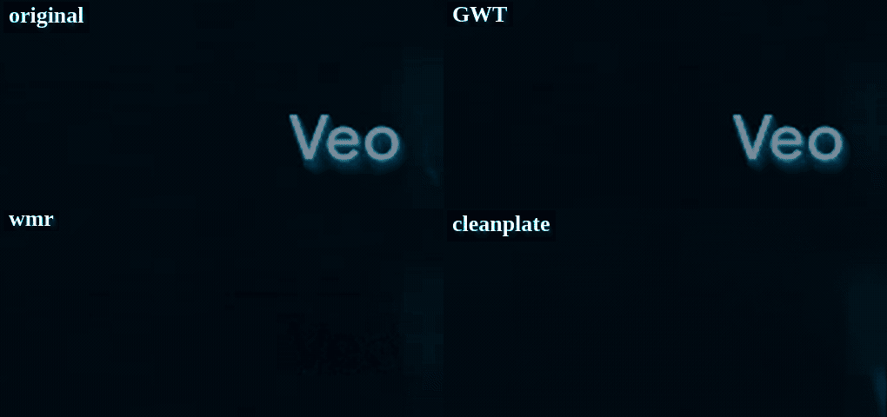
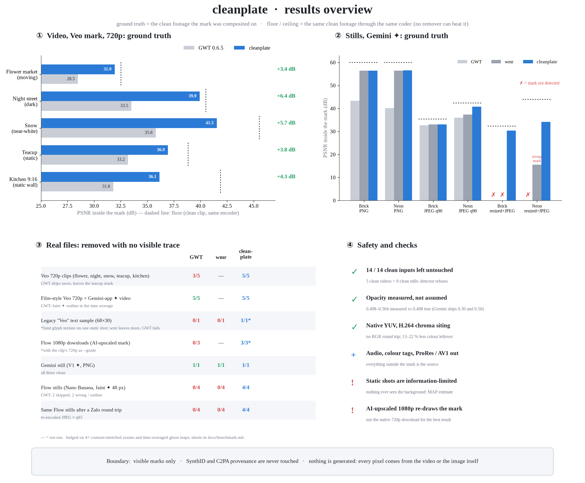
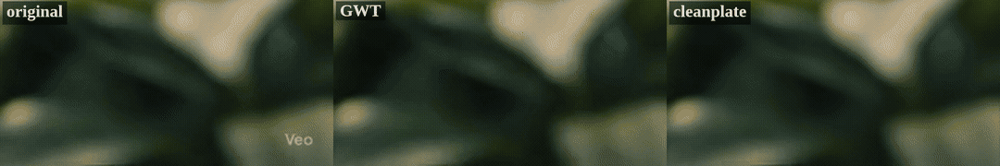
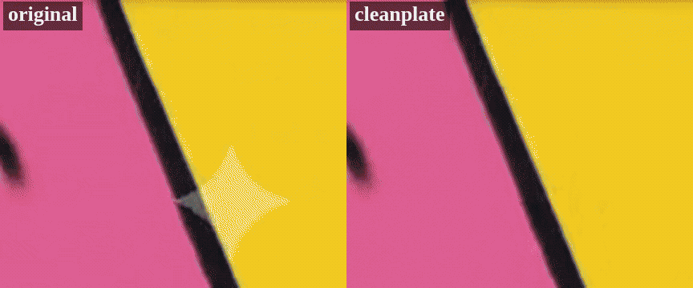
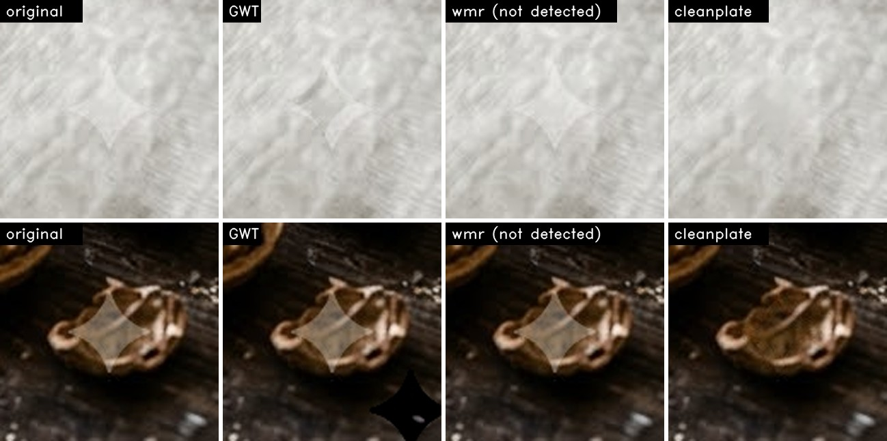

<div align="center">

# cleanplate

### Xoá logo AI hiển thị, giữ nguyên hình. Không bịa chi tiết, không làm nhoè.

[](https://github.com/dieplai/cleanplate/actions/workflows/ci.yml)
[](https://github.com/dieplai/cleanplate/releases/latest)
[](https://github.com/dieplai/cleanplate/releases)
[](./LICENSE)
[](#cài-đặt)
[](https://dieplai.github.io/cleanplate/)

[English](./README.md) · **Tiếng Việt**

</div>

<p align="center"></p>

cleanplate xoá các logo **hiển thị** mà công cụ AI đóng lên sản phẩm (chữ "Veo" của Google Veo và hình ✦ của
Gemini / Nano Banana) khỏi **video và ảnh**, trả lại hình trông như chưa từng có logo. Công cụ dành cho người làm nội
dung dùng các AI này cho mục đích phi thương mại, cần một khung hình sạch cho cảnh phim, bản dựng hay thumbnail.

Các tool khác đảo lớp phủ từng frame rồi che phần còn sót bằng làm mờ hoặc AI vẽ lại, nên để lại một mảng nhoè.
cleanplate tận dụng điều video vốn có: **cảnh chuyển động bên dưới logo, nên gần như mọi điểm ảnh bị che đều lộ ra
sạch sẽ ở một frame khác.** Nó dựng lại vùng logo từ chính các điểm ảnh thật đó. Với ảnh tĩnh, nó đo độ phủ và vị trí
chính xác của logo ngay trên ảnh của bạn thay vì giả định.

| Đo với đáp án, PSNR trong vùng logo (dB, càng cao càng tốt) | GWT 0.6.5 | wmr 1.17 | **cleanplate** | trần |
|---|---|---|---|---|
| Video, Veo 720p, 5 clip (trung bình) | 32.6 | - | **37.3** | 39.9 |
| Ảnh, Gemini ✦ PNG (gạch / neon) | 43.4 / 40.2 | 56.4 / 56.4 | **56.4 / 56.5** | 60 |
| Ảnh, lưu lại JPEG (gạch / neon) | 32.7 / 36.0 | 33.0 / 37.3 | **33.0 / 40.8** | 35.4 / 42.3 |
| Ảnh, thu nhỏ + JPEG như bản chia sẻ | không phát hiện | không phát hiện / sai | **30.4 / 34.1** | 32.3 / 43.9 |

<sub>Trần = cảnh sạch đi qua cùng codec. Không công cụ nào vượt được. Từng clip và cách đo từng con số:
<a href="./docs/benchmark.md">docs/benchmark.md</a>.</sub>

> [!IMPORTANT]
> **Chỉ xoá logo hiển thị.** cleanplate không động tới SynthID (watermark ẩn) hay thông tin nguồn gốc C2PA. Hãy ghi
> nhãn nội dung do AI tạo theo quy định của nền tảng và kỳ vọng của người xem.

## Mục lục

[Kết quả](#kết-quả) · [Cài đặt](#cài-đặt) · [Cách dùng](#cách-dùng) · [Chất lượng tốt nhất](#để-có-chất-lượng-tốt-nhất) ·
[Phương pháp](#phương-pháp) · [Hiệu năng](#hiệu-năng) · [Giới hạn](#giới-hạn-đã-biết) · [Ủng hộ](#-ủng-hộ) ·
[Giấy phép](#giấy-phép) · [Ghi công](#ghi-công) · [Tài liệu tham khảo](#tài-liệu-tham-khảo)

## Kết quả



<table>
<tr>
<td width="50%"><br><sub>Veo 3.1, cảnh chuyển động: gốc · GWT · cleanplate</sub></td>
<td width="50%"><br><sub>Gemini ✦ trên chuyển động nhanh (20 px/frame): gốc · cleanplate</sub></td>
</tr>
</table>

<p align="center"><br>
<sub>Ảnh Flow (Nano Banana) thật với ✦ 48 px mờ. GWT vẽ một hình thoi tối sai chỗ, wmr không phát hiện ra logo.</sub></p>

## Cài đặt

### Cách 1 - dùng trên trình duyệt (không cần cài gì)

Mở **[dieplai.github.io/cleanplate](https://dieplai.github.io/cleanplate/)** bằng Chrome hoặc Edge rồi kéo file vào.
Mọi thứ chạy trên máy bạn, dùng tất cả nhân CPU. File không được tải lên đâu cả. Ảnh cho kết quả giống hệt CLI. Video
được nén lại bằng H.264.

### Cách 2 - tải công cụ dòng lệnh

| Hệ điều hành | Tải về | Sau đó |
|---|---|---|
| **Windows** 10/11 (x64) | [cleanplate-windows-x86_64.zip](https://github.com/dieplai/cleanplate/releases/latest/download/cleanplate-windows-x86_64.zip) | Giải nén. Chạy `cleanplate.exe` từ terminal trong thư mục đó (chưa ký số: nếu SmartScreen hỏi, chọn *More info → Run anyway*) |
| **macOS** (Apple Silicon và Intel) | [cleanplate-macos-universal.tar.gz](https://github.com/dieplai/cleanplate/releases/latest/download/cleanplate-macos-universal.tar.gz) | `tar xzf`. Chạy một lần: `xattr -d com.apple.quarantine cleanplate` |
| **Linux** x86_64 (glibc 2.35+) | [cleanplate-linux-x86_64.tar.gz](https://github.com/dieplai/cleanplate/releases/latest/download/cleanplate-linux-x86_64.tar.gz) | `tar xzf`. Tuỳ chọn chép `cleanplate` vào `~/.local/bin` |

**Xử lý video cần thêm [ffmpeg](https://ffmpeg.org) trong PATH** (ảnh thì không cần):

| Hệ điều hành | Lệnh |
|---|---|
| Windows | `winget install --id Gyan.FFmpeg -e`, rồi mở một terminal **mới** |
| macOS | `brew install ffmpeg` |
| Ubuntu / Debian | `sudo apt install ffmpeg` |
| Fedora | `sudo dnf install ffmpeg-free` (không có x264: cleanplate sẽ xuất AV1) |

### Cách 3 - build từ mã nguồn

```bash
git clone https://github.com/dieplai/cleanplate.git && cd cleanplate
cargo install --path crates/cleanplate-cli      # Rust ≥ 1.88 (https://rustup.rs); ~1–3 phút
```

## Cách dùng

```bash
cleanplate photo.png photo_clean.png            # ảnh: vào PNG, JPG hoặc WebP; ra cùng hoặc khác định dạng
cleanplate clip.mp4 clip_clean.mp4              # video: H.264 (hoặc AV1), giữ âm thanh và thông tin màu
cleanplate clip.mp4 clip_clean.mov              # ProRes 422 HQ để dựng phim
cleanplate clip.mp4 clip_clean.mkv              # FFV1 lossless
cleanplate clip_1080p.mp4 out.mov --guide clip_720p_clean.mov   # bản tải AI upscale + bản 720p đã làm sạch
```

Trên Windows, khi chạy trong thư mục vừa giải nén thì gõ `.\cleanplate.exe` thay cho `cleanplate`.

| Tuỳ chọn | Ý nghĩa |
|---|---|
| `--codec auto\|h264x\|av1\|h264\|prores\|ffv1` | Bộ mã hoá video. `auto` chọn theo đuôi file ra và những gì ffmpeg của bạn có |
| `--guide FILE` | Với bản tải Flow 1080p / 4K: cùng clip ở 720p, đã làm sạch |
| `--threads N` | Số luồng (mặc định: tất cả nhân CPU) |
| `--lam`, `--k`, `--min-ncc`, `--opaque`, `--no-edge-tv` | Tinh chỉnh nâng cao. Xem `cleanplate --help` |

**Mã thoát:** `0` đã xoá · `2` không tìm thấy logo đủ chắc chắn, **không ghi gì** (file gốc không bao giờ bị sửa) ·
`1` lỗi (thông báo nói rõ cần làm gì, ví dụ cách cài ffmpeg).

## Để có chất lượng tốt nhất

- **Tải bản độ phân giải gốc.** Trong Flow chọn 720p "original size". Bản 1080p và 4K của Flow là AI upscale từ video
  *đã có logo*: logo bị vẽ lại và phá một phần chi tiết bên dưới. Nếu chỉ có bản 1080p, hãy làm sạch thêm bản 720p
  rồi truyền vào bằng `--guide`.
- **Dùng file đúng như lúc tải về.** Mỗi lần nén lại (app nhắn tin, mạng xã hội, quay màn hình) làm mất chi tiết mà
  phương pháp cần. cleanplate vẫn xử lý được bản đã thu nhỏ hoặc nén lại, nhưng độ chính xác thấp hơn.
- **Lưu ảnh dạng PNG.** PNG không mất dữ liệu. Xuất JPEG sẽ nén lại toàn bộ ảnh.
- **Để dựng phim, xuất `.mov` (ProRes) hoặc `.mkv` (FFV1)** để công cụ tiếp theo nhận file không mất dữ liệu.

## Phương pháp

**Bài toán.** Công cụ AI chồng một logo tĩnh, bán trong suốt lên mọi frame rồi mới nén:
`J_t = C((1 − α)·I_t + α·L)`, với độ phủ `α ≤ 0.55` ở mọi logo của Google đã đo và `L` là màu trắng. Đảo ngược trên
từng frame, `Î_t = (J_t − α·L) / (1 − α)` [1], sẽ chia sai số nén của `C` cho `1 − α` (tới ×2,2 trên nét chữ): hình
nhấp nháy, và trên nền tĩnh còn lại một vệt hình logo mà làm mờ hay AI vẽ lại chỉ che được chứ không xoá được.

**Nhận xét then chốt.** Logo đứng yên trong khung hình còn cảnh thì chuyển động, nên một điểm bị che ở thời điểm *t*
thường lộ ra hoàn toàn ở một thời điểm *s* khác. Cleanplate ước lượng mỗi điểm ảnh bị che từ chính những lần quan sát
đó, tìm bằng optical flow, thay vì tự vẽ ra: ý tưởng lan truyền của video inpainting theo flow [5, 6], nhưng không có
thành phần học máy nào.

**Quy trình cho video.**

1. **Dò logo.** Tương quan chéo chuẩn hoá trừ trung bình [7] giữa các mẫu logo và trung bình theo thời gian của góc
   dưới bên phải sau lọc thông cao, tại các vị trí và tỉ lệ quen thuộc của từng công cụ. Dưới ngưỡng tin cậy thì trả
   lại file nguyên vẹn.
2. **Cắt cảnh.** Phát hiện điểm cắt từ ảnh thu nhỏ của từng frame. Không lần quan sát nào đi qua điểm cắt.
3. **Đảo ngược trong YUV gốc** theo vị trí lấy mẫu màu của H.264 (kênh màu dùng α trung bình 2×2 và `L = 128`),
   không đổi qua RGB.
4. **Gom theo thời gian.** Với mỗi frame lân cận *s* trong khoảng ±K: optical flow Dense Inverse Search [2] với bước
   tinh chỉnh biến phân có số hạng dữ liệu chuẩn hoá như [3], được điền lại bên trong logo từ vùng xung quanh, và
   kiểm tra nhất quán xuôi-ngược [8]. Mỗi ứng viên có trọng số theo nghịch đảo phương sai nhiễu (quan sát sạch ≈ 1,
   phép đảo `(1 − α)²`), độ tin cậy của flow và độ suy giảm theo thời gian.
5. **Gộp bền vững.** Ứng viên lệch khỏi phép đảo của chính frame đó quá sai số của codec thì bị loại, riêng cho kênh
   sáng và từng kênh màu, rồi gộp với trọng số bền vững.
6. **Tinh chỉnh MAP.** Nơi không có quan sát sạch nào, dùng ước lượng biến phân toàn phần có trọng số [4],
   `min_I Σ w·(I − μ)² + λ·TV(I)`, với λ chọn theo chuyển động đo được của từng cảnh (16 cho cảnh tĩnh, 0 cho cảnh
   động) và trên viền mỏng của logo.
7. **Ghép.** Vùng dựng lại được dán mềm viền vào frame không bị đụng tới. Âm thanh và thông tin màu được giữ nguyên.

**Ảnh tĩnh.** Hình ✦ được dò ở mọi kích thước bằng cùng phép tương quan. Độ phủ, độ lệch dưới một pixel và kích thước
lẻ được *đo trên chính ảnh* (điểm đổi dấu của tương quan gradient có dấu qua viền logo), vì Google từng dùng cùng một
hình ở α = 0.30 và 0.50. Lớp phủ được đảo chính xác [1]. Ảnh JPEG và WebP có thêm một bước TV có trọng số thích ứng
theo kết cấu [4], chỉ trên vùng logo.

**An toàn.** Không khớp đủ chắc, độ phủ đo được dưới 0.15, hoặc ảnh quá nhỏ để chứa logo: không ghi gì cả (14 / 14
file sạch bị từ chối).

Đặc tả chạy được nằm trong [`research/`](./research). Bằng chứng cho từng bước và các ý tưởng đã thử rồi loại nằm trong
[`docs/method.md`](./docs/method.md) và [`docs/benchmark.md`](./docs/benchmark.md).

## Hiệu năng

Trên laptop 12 nhân: clip 720p dài 8 giây mất **3-9 giây** (cảnh tĩnh 9:16 mất 18 giây), ảnh 2528×1696 mất **2 giây**:
**nhanh hơn bản Python tham chiếu khoảng 16 lần với cùng chất lượng** (cổng đo có đáp án trên 8 clip: trung bình 36,65
so với 36,64 dB, ảnh giống hệt từng bit, [`bench/rust_vs_python.sh`](./bench/rust_vs_python.sh)). Bản trình duyệt chạy
cùng core dưới dạng WebAssembly trên mọi nhân (laptop 12 luồng, Chrome: 2,6 giây cho ảnh đó, 8 giây cho clip đó,
14 giây cho cảnh tĩnh 1080p). Trình duyệt nào không chia sẻ được bộ nhớ giữa các luồng thì tự chạy một luồng.

Mã Rust chia thành [`cleanplate-core`](./crates/cleanplate-core) (toàn bộ thuật toán, không đụng file hay hệ điều
hành) và [`cleanplate-cli`](./crates/cleanplate-cli) (đọc ghi file và ffmpeg).
[`cleanplate-wasm`](./crates/cleanplate-wasm) + [`web/`](./web) là trang trình duyệt. Mã Python trong
[`research/`](./research) là đặc tả tham chiếu và bộ benchmark.

## Giới hạn đã biết

- **Cảnh tĩnh bị giới hạn thông tin.** Nếu nền dưới logo không bao giờ lộ ra, cleanplate trả về hình có khả năng
  đúng nhất, không phải chi tiết mà codec đã vứt bỏ (trường hợp xấu nhất: cảnh bếp 9:16, 36,2 so với 41,9 dB).
- **Bản tải AI upscale** (Flow 1080p / 4K) vẽ lại logo theo từng nền. Không có `--guide` 720p thì cảnh tĩnh còn một
  mảng mờ nhẹ.
- **Logo trên nền trắng tuyệt đối** (≤ 7 mức trên 253) không công cụ nào phát hiện được, kể cả cleanplate. Khi đó
  logo cũng gần như vô hình.
- Video trên trình duyệt cần Chrome hoặc Edge và file MP4 / MOV H.264. Định dạng khác hãy dùng CLI.

## 💖 Ủng hộ

Nếu cleanplate giúp bạn tiết kiệm thời gian, hãy tặng dự án một ⭐ trên GitHub hoặc tài trợ để phát triển tiếp:

<a href="https://github.com/sponsors/dieplai"></a>

## Giấy phép

MIT. Mã nguồn, mẫu logo, font và thư viện lấy từ các dự án khác, cùng giấy phép của chúng, được liệt kê trong
[`LICENSE-THIRD-PARTY.md`](./LICENSE-THIRD-PARTY.md).

## Ghi công

Dự án được xây dựng trên nghiên cứu và mã nguồn từ:

- [froggeric/gemini-watermark-and-synthid-remover](https://github.com/froggeric/gemini-watermark-and-synthid-remover)
  (Frédéric Guigand): các mẫu logo ✦ Gemini và chữ Veo bản cũ (MIT). Công cụ `wmr` 1.17 của dự án là một mốc so sánh
  trong benchmark
- [allenk/GeminiWatermarkTool](https://github.com/allenk/GeminiWatermarkTool) (AllenK): đảo alpha-blend trên từng
  frame kèm dò NCC. GWT 0.6.5 là mốc so sánh chính trong benchmark
- [ishara-madu/gemini-watermark-remover](https://github.com/ishara-madu/gemini-watermark-remover) (Ishara
  Madushanka): bố cục trang web và logo (MIT). Phần lõi xoá logo được port lại chỉ để so sánh
- [OpenCV](https://github.com/opencv/opencv): optical flow Dense Inverse Search và các phép xử lý ảnh cơ bản, viết lại
  bằng Rust theo cách OpenCV hiện thực (Apache-2.0)
- [rayon](https://github.com/rayon-rs/rayon), [RustFFT](https://github.com/ejmahler/RustFFT),
  [image](https://github.com/image-rs/image), [jpeg-encoder](https://github.com/vstroebel/jpeg-encoder),
  [clap](https://github.com/clap-rs/clap): xử lý song song, FFT, đọc ghi ảnh và giao diện dòng lệnh
- [mp4box.js](https://github.com/gpac/mp4box.js), [mp4-muxer](https://github.com/Vanilagy/mp4-muxer),
  [coi-serviceworker](https://github.com/gzuidhof/coi-serviceworker), font Plus Jakarta Sans (Tokotype): trang web
- Các bài báo trong mục [Tài liệu tham khảo](#tài-liệu-tham-khảo): phương pháp được xây trên nền của chúng

Mọi đóng góp đều được hoan nghênh: đọc [CONTRIBUTING.md](./CONTRIBUTING.md). Muốn khẳng định "tốt hơn" cần có số đo từ
`research/score_gt.py` hoặc `research/img_bench.py` và hình so sánh trực quan.

## Tài liệu tham khảo

1. T. Dekel, M. Rubinstein, C. Liu, W. T. Freeman. *On the Effectiveness of Visible Watermarks.* CVPR 2017.
2. T. Kroeger, R. Timofte, D. Dai, L. Van Gool. *Fast Optical Flow using Dense Inverse Search.* ECCV 2016.
   [arXiv:1603.03590](https://arxiv.org/abs/1603.03590)
3. H. Zimmer, A. Bruhn, J. Weickert. *Optic Flow in Harmony.* International Journal of Computer Vision 93(3), 2011.
4. L. I. Rudin, S. Osher, E. Fatemi. *Nonlinear total variation based noise removal algorithms.* Physica D 60, 1992.
5. Z. Li, C.-Z. Lu, J. Qin, C.-L. Guo, M.-M. Cheng. *Towards An End-to-End Framework for Flow-Guided Video
   Inpainting.* CVPR 2022. [arXiv:2204.02663](https://arxiv.org/abs/2204.02663)
6. S. Zhou, C. Li, K. C. K. Chan, C. C. Loy. *ProPainter: Improving Propagation and Transformer for Video Inpainting.*
   ICCV 2023. [arXiv:2309.03897](https://arxiv.org/abs/2309.03897)
7. J. P. Lewis. *Fast Normalized Cross-Correlation.* Vision Interface 1995.
8. N. Sundaram, T. Brox, K. Keutzer. *Dense Point Trajectories by GPU-Accelerated Large Displacement Optical Flow.*
   ECCV 2010.
